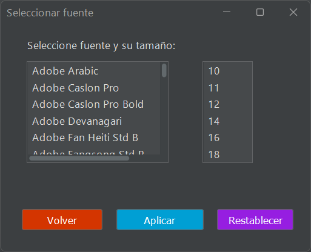
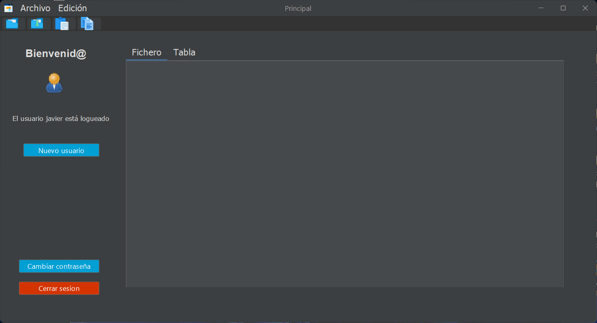

# Práctica 3.2 - Rediseño y entrega de una aplicación de escritorio 

Esta práctica forma parte del **proyecto evaluable del trimestre**, integrando aspectos de diseño, programación, pruebas y despliegue de aplicaciones de escritorio, por lo que su correcta realización y documentación serán fundamentales para la valoración final del módulo.

Su objetivo es, partiendo de lo trabajo en la *práctica 3.1*, aplicar los principios fundamentales de **diseño de interfaces gráficas** y **usabilidad** en una aplicación desarrollada en Java Swing. Se deberá diseñar y **documentar** una **guía de estilo** personalizada que defina la paleta de colores, tipografía y elementos visuales coherentes con la identidad de su proyecto, además de implementar mejoras visuales y funcionales que favorezcan la experiencia del usuario.
Asimismo, se trabajará la configuración de la aplicación mediante un fichero externo, el uso de componentes visuales avanzados como *JCalendar* o *JTabbedPane*, la incorporación de temas visuales (modo claro/oscuro), tipografía dinámica y la creación de un **ejecutable** funcional (.exe) para Windows. 

## Preparación del proyecto

1. Crea el proyecto Maven `SOL/practica3-2` a partir de una versión funcional de la 3.1. Utiliza Java 21 y conserva los formularios de NetBeans, los recursos y las pruebas.
2. Mantén la separación **Modelo–VistaControlador** que utilizaste en la práctica anterior. Las ventanas recogen datos y muestran resultados. El modelo valida y realiza las operaciones sobre la base de datos.
3. Reutiliza el servicio MySQL de Aiven y el esquema de prácticas. Trabaja con cuentas, nombres y correos ficticios.
4. Utiliza las ramas `parte-1`, `parte-2` y `parte-3`. Integra cada parte comprobada en `main`, realiza commits descriptivos y registra en Issues los fallos que encuentres y su resolución.

### Elige el contexto de uso

Antes de diseñar, escribe un breve planteamiento con el **nombre de la aplicación**, a quién va dirigida y qué tareas va a facilitar. Por ejemplo, un gimnasio puede consultar a sus socios y guardar notas de actividades.  

Este contexto debe reflejarse en los nombres de las secciones, en los datos de ejemplo y en al menos una decisión de diseño.

Implementa los requisitos comunes y elige una mejora propia que tenga sentido para las personas que usarían la aplicación.

## Parte 1 Diseño, registro y configuración

### Mejora de la ventana de registro

Conserva las reglas de la 3.1 para usuario, contraseña, confirmación y cuentas duplicadas. Añade validación a los datos opcionales **cuando tengan contenido**:

| Campo | Comprobación |
|---|---|
| Nombre y apellidos | Comprueba la longitud admitida por la base de datos. Admite nombres con tildes, espacios, guiones y apóstrofos. |
| Correo electrónico | Comprueba que tiene una estructura básica válida y que no contiene espacios. |
| Fecha de nacimiento | Utiliza un selector visual, como `JDateChooser`, y permite borrar la selección. Admite una fecha válida igual o anterior a la fecha actual. |

### Fichero de configuración de Aiven

La configuración de la base de datos deberá de leerse de un fichero `config.properties` en lugar de estar escrita en el código.

Ejemplo de fichero `config.properties`:
```
db.url=jdbc:mysql://di-agenda-di-contactos-26.k.aivencloud.com:27428/usuarios
db.user=avnadmin
db.password=1234
```

Ayúdate de la clase `Properties` para leer ficheros de configuración:

```java
Properties propiedades = new Properties();
propiedades.load(new FileReader("src/main/resources/config_derby.properties"));
url_bd = propiedades.getProperty("url_bd");
user = propiedades.getProperty("user");
pwd = propiedades.getProperty("pwd");    
```

## Parte 2 Ventana principal y mejora propia

Organiza la ventana principal en dos zonas y nuevas funciones. Un **panel lateral** identifica la aplicación y permite cambiar de sección. El **área de trabajo** muestra el título, las acciones y el contenido de la sección activa. Reserva espacio para mensajes como «Cargando directorio», «Archivo guardado» o «Hay cambios sin guardar».

En Swing puedes construir la pantalla con un `JPanel` lateral y un panel central con `CardLayout` para alternar las vistas. También puedes conservar un `JTabbedPane` si encaja en tu diseño. Marca la sección activa, mantén las acciones de cuenta en una ubicación previsible y comprueba que el contenido sigue siendo legible al redimensionar.

### Menú lateral

- Identifica al usuario que ha iniciado sesión y mantén disponible **Cerrar sesión**.
- Añade otro nuevo botón que permita **modificar la contraseña** del usuario que esté actualmente logueado desde otra nueva ventana. 
- Permite alternar entre **tema claro y oscuro** con FlatLaf. Comprueba la legibilidad y el aspecto de las ventanas y diálogos al cambiar de tema.	

### Menú superior

Agrega un menú superior con las opciones de **archivo** y **edición**:
- El menú **archivo** tendrá la opción de abrir y guardar archivos de tipo texto, cuyo contenido se cargará en el *JTextArea* central de la ventana principal.
- El menú **edición** deberá tener un **selector de fuentes**. Al hacer clic abrirá una  ventana que permitará la fuente y seleccionar su tamaño para aplicar en toda la interfaz.



### Apartados principales 

- Deberá mostrar un apartado para mostrar el contenido del **fichero de texto**. Agrega la opción para poder editar su contenido y también poder abrir oguardar los cambios desde el menú **archivo**.
- Otro apartado que muestre el contenido de una **tabla** *JTable* que sea el resultado de consultar el contenido de los usuarios dados de alta actualmente en el sistema (base de datos de usuarios), mostrando todos sus campos en diferentes columnas. 




### Mejora propia

Implementa **una** mejora que resuelva una necesidad de tu contexto. Puedes elegir una de estas propuestas o plantear otra de alcance parecido:

| Idea | Ejemplo |
|---|---|
| Localizar registros | Filtrar el directorio por nombre o usuario. |
| Agilizar tareas frecuentes | Añadir una barra de herramientas o un menú contextual al editor. Reutiliza las acciones que ya existen. |
| Adaptar la lectura | Elegir un tamaño de letra o un color para el editor, manteniendo la legibilidad. |
| Preparar documentos habituales | Incorporar una plantilla de notas según el ámbito de la aplicación. |
| Añadir una vista de detalle | Mostrar los datos relevantes del registro seleccionado. |
| Añadir un selector de color de tema | Utiliza un selector de color para modificar colores de componentes del tema |

Documenta qué problema resuelve, cómo se utiliza y cómo has comprobado su funcionamiento.

## Parte 3. Pruebas y distribución

### Pruebas automatizadas

Vuelve a ejecutar las pruebas de la 3.1 como **regresión**. Mantén **JUnit 4** y **AssertJ Swing** con ámbito `test`.

Agrega alguna prueba adicional.

### Empaquetado y entrega

1. Genera y prueba el **JAR con dependencias** de la práctica anterior.
2. Genera una **distribución para Windows**. Puedes usar `jpackage --type app-image` y entregar la carpeta que contiene el lanzador `.exe`, o usar Launch4j y documentar el entorno Java que necesita su lanzador. Si optas por un instalador con `jpackage --type exe`, sigue los requisitos de la herramienta en Windows. [Guía de empaquetado de Java 21](https://docs.oracle.com/en/java/javase/21/jpackage/packaging-overview.html).
3. Ejecuta la distribución desde una carpeta distinta a la del proyecto y comprueba el arranque, los recursos y la lectura de la configuración privada.
4. Entrega el repositorio con el código y las pruebas. Enlaza desde el README del repositorio `docs/index.md`, la guía de estilo y el informe de pruebas. Adjunta el JAR y la distribución o indica dónde descargarlos.

En `docs/index.md` incluye el contexto de uso, las funciones, capturas de la versión final, la organización del código, los pasos de configuración y ejecución, y el resultado de la revisión de usabilidad. Incluye el script SQL si has cambiado el esquema. Publica la plantilla de configuración con datos de ejemplo.


### Uso Launch4J (Windows)

- Descarga e instala *Launch4j*.
- Crea un nuevo proyecto en Launch4j y especifica el archivo JAR de tu proyecto en la sección "Jar".
- Configura los parámetros que necesites, como la versión mínima de Java y el icono del ejecutable.
- Selecciona el archivo de salida (.exe) y guarda el proyecto.
- Haz clic en *Build wrapper* para generar el .exe.

### Comprobaciones de integración y pruebas manuales


Conserva las pruebas de regresión de la 3.1 y añade los siguientes casos a `TEST/casos-prueba.md`. Registra el resultado, la fecha y una evidencia cuando aporte información.

| ID | Caso | Entrada o acción | Resultado esperado | Resultado |
|---|---|---|---|---|
| 3.2-R01 | Regresión de 3.1 | Ejecutar las pruebas previas | Pasan las comprobaciones de validación y del login | Pendiente |
| 3.2-U01 | Nuevas reglas | Ejecutar los casos JUnit 4 | Las entradas válidas se aceptan y las inválidas se rechazan | Pendiente |
| 3.2-G01 | Nueva prueba de interfaz | Ejecutar el caso elegido de AssertJ Swing | Se cumplen las aserciones documentadas | Pendiente |
| 3.2-I01 | Configuración externa | Abrir el JAR con una configuración válida e iniciar sesión | La aplicación lee el archivo y conecta con Aiven | Pendiente |
| 3.2-I02 | Configuración ausente | Arrancar con una copia de prueba incompleta o ausente | Se indica cómo corregir el problema y la aplicación sigue abierta | Pendiente |
| 3.2-I03 | Registro y directorio | Crear una cuenta ficticia sin datos opcionales y actualizar la tabla | La cuenta aparece y se muestran solo las columnas del directorio | Pendiente |
| 3.2-I04 | Fallo de consulta | Tras iniciar sesión, desconectar temporalmente el equipo de pruebas y pulsar **Actualizar** | La interfaz informa del fallo y permite reintentar cuando se recupera la conexión | Pendiente |
| 3.2-I05 | Cambio de contraseña | Probar primero una contraseña actual incorrecta y después un cambio válido | El intento incorrecto se rechaza. Tras el cambio, solo funciona la nueva contraseña | Pendiente |
| 3.2-M01 | Selector de fecha | Elegir una fecha pasada, borrarla y probar con una futura | Se admite la fecha pasada o el campo vacío. Se rechaza la futura | Pendiente |
| 3.2-M02 | Abrir y guardar | Editar, guardar y volver a abrir un texto con tildes y saltos de línea | Se conserva el contenido | Pendiente |
| 3.2-M03 | Cambios pendientes | Editar una nota, intentar salir y cancelar | La aplicación conserva la nota y permite seguir editando | Pendiente |
| 3.2-M04 | Navegación y temas | Recorrer controles con el teclado y cambiar de tema | El foco se distingue, las acciones se localizan y el texto es legible | Pendiente |
| 3.2-M05 | Mejora propia | Ejecutar el recorrido que documentaste para la mejora | Se obtiene el resultado definido para esa tarea | Pendiente |
| 3.2-M06 | Distribución | Ejecutar desde otra carpeta con la configuración externa | El programa abre fuera de NetBeans y mantiene los recursos y la conexión | Pendiente |

Usa **OK**, **No cumple** o **No ejecutado**. Describe los fallos encontrados y vuelve a comprobarlos tras corregirlos.

### Documentación y entrega

En `docs/index.md` incluye descripción, funcionalidades, capturas, responsabilidades de los paquetes, preparación de Aiven, valores del url accedido —sin sus valores secretos—, ejecución del JAR y ejecución de pruebas. Documenta con Javadoc las clases principales del modelo y al menos dos de sus métodos.

Añade al README un enlace a la documentación y al informe de pruebas. Si mantienes GitHub Pages de las prácticas previas, comprueba su publicación.

Antes de entregar:

- [ ] Maven, FlatLaf y los paquetes siguen la organización trabajada.
- [ ] El código respeta la separación Modelo–VistaControlador.
- [ ] Login, registro y cierre de sesión funcionan con Aiven.
- [ ] Las reglas de validación están en `ValidadorUsuario`.
- [ ] La conexión utiliza el host y puerto reales de Aiven y las credenciales configuradas.
- [ ] Los datos de conexión están centralizados en las variables de clase de `ConexionBD`.
- [ ] Los campos opcionales pueden quedar vacíos y los informados se guardan.
- [ ] La versión publicada del código, las capturas y la documentación utilizan valores de ejemplo para las credenciales.
- [ ] Se validan los obligatorios, se admiten opcionales vacíos y se evitan duplicados.
- [ ] Las conexiones, sentencias y resultados JDBC se cierran correctamente.
- [ ] Pasan los cuatro casos unitarios y al menos una prueba con AssertJ Swing.
- [ ] Se han ejecutado y documentado las comprobaciones reales con Aiven.
- [ ] Se ha realizado la revisión de usabilidad según los requerimientos y registrado sus conclusiones.
- [ ] El JAR se ejecuta fuera de NetBeans y la documentación permite reproducirlo.
- [ ] Las ramas están integradas en `main` y las incidencias quedan identificadas.