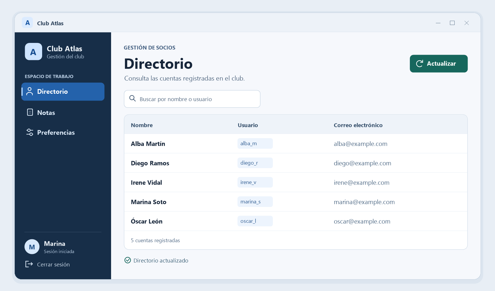
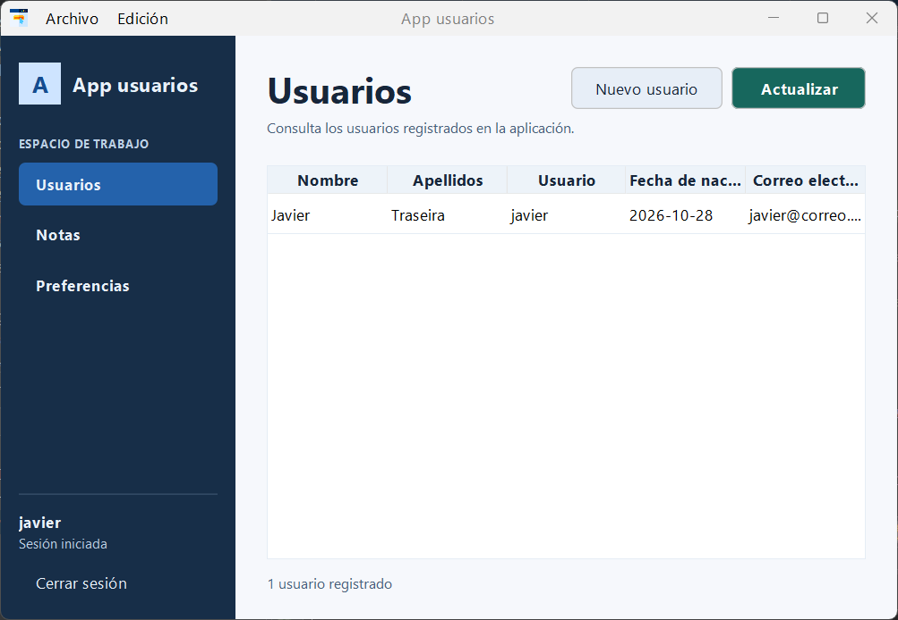
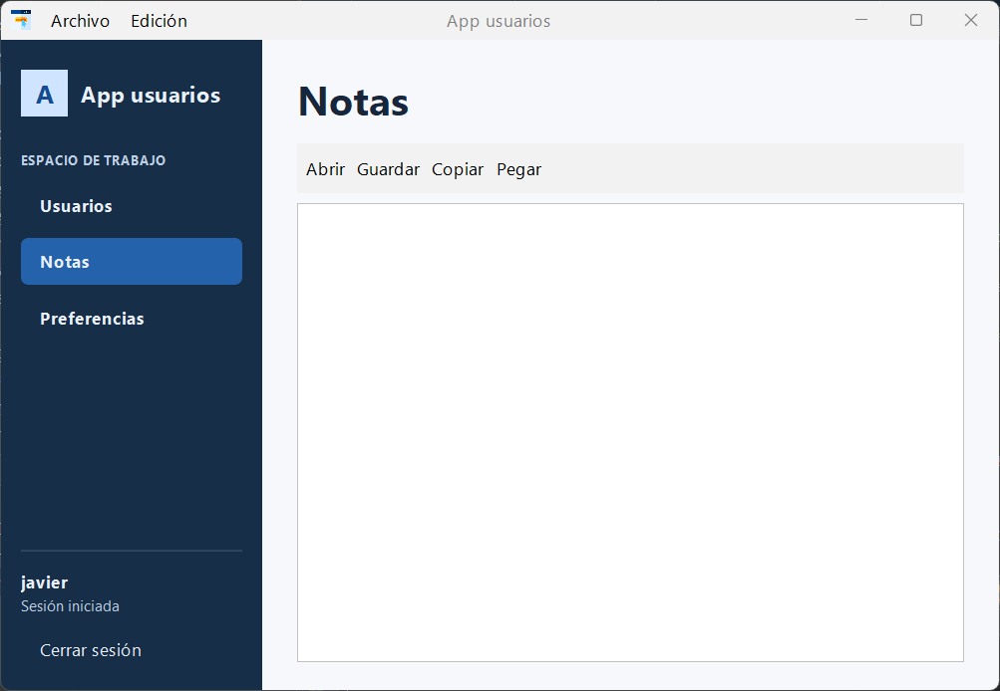
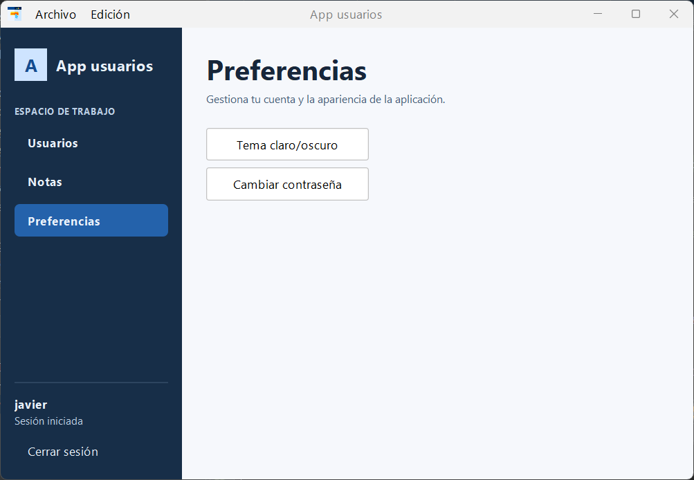

# Práctica 3.2 - Rediseño y entrega de una aplicación de escritorio 

Esta práctica forma parte del **primer proyecto evaluable**, integrando aspectos de diseño, programación, pruebas y despliegue de aplicaciones de escritorio, por lo que su correcta realización y documentación serán fundamentales para la valoración final del módulo.

Amplía el proyecto de la **práctica 3.1** hasta convertirlo en una aplicación de escritorio que puedas entregar y defender. Mantendrás el acceso y el registro con **Java Swing, FlatLaf y MySQL en Aiven**. Después rediseñarás la ventana principal para consultar usuarios, editar notas y gestionar la cuenta.


### Elige el contexto de uso

Elige un contexto, como un gimnasio, un club o un aula. Define **quién utilizará la aplicación y qué tareas realizará**. Refleja esa elección en el nombre de la aplicación, los datos ficticios y al menos una decisión de la guía de estilo. Además de la base común, implementa **una mejora propia** que facilite una de esas tareas.

## Preparación del proyecto

1. Crea el proyecto Maven `SOL/practica3-2` a partir de una versión funcional de la 3.1. Utiliza Java 21 y conserva los formularios de NetBeans, los recursos y las pruebas.
2. Mantén la separación **Modelo–VistaControlador** que utilizaste en la práctica anterior. Las ventanas recogen datos y muestran resultados. El modelo valida y realiza las operaciones sobre la base de datos.
3. Reutiliza el servicio MySQL de Aiven y el esquema de prácticas. Trabaja con cuentas, nombres y correos ficticios.
4. Utiliza las ramas `parte-1`, `parte-2` y `parte-3`. Integra cada parte comprobada en `main`, realiza commits descriptivos y registra en Issues los fallos que encuentres y su resolución.

## Parte 1 Diseño, registro y configuración. Guía de estilo

### Mejora la ventana de registro

Conserva las reglas de la 3.1 para usuario, contraseña, confirmación y cuentas duplicadas. Añade validación a los datos opcionales **cuando tengan contenido**:

| Campo | Comprobación |
|---|---|
| Nombre y apellidos | Comprueba una longitud mínima y máxima.  |
| Correo electrónico | Comprueba que tiene una estructura básica válida. |
| Selector de fecha de nacimiento | Utiliza de selector visual de guía `JDateChooser` |

Para el **selector de fecha de nacimiento** usar `JDateChooser`:

1. Añade la dependencia. Incluye `com.toedter:jcalendar:1.4` en el `pom.xml` y compila el proyecto para que Maven descargue el JAR.
2. Añade el componente a Matisse. Ve a **Tools → Palette → Swing/AWT Components → Add from JAR…**. Selecciona *jcalendar-1.4.jar* en tu repositorio local de Maven y elige `JDateChooser`. Arrástralo al formulario y configura `dateFormatString` como `dd/MM/yyyy`.
3. Adapta el código del registro. Lee la fecha con `getDate()`. Si está vacía, guarda `NULL`. Si tiene valor, conviértela a `LocalDate` y guárdala como `DATE` en MySQL.


### Fichero de configuración de Aiven

En la *práctica 3.1* los datos de conexión estaban escritos en `ConexionBD`. Ahora los leerás de un fichero llamado `config_mysql.properties`. 

Para las primeras pruebas desde NetBeans, guárdalo en `src/main/resources`, pero debería de estar en tu carpeta de usuario *home*.

```properties
url_bd=jdbc:mysql://HOST_AIVEN:PUERTO_AIVEN/usuarios
user=avnadmin
pwd=CONTRASENA_MYSQL
```

En `ConexionBD`, carga el fichero dentro de `abrir()` mediante `Properties` y un lector que se cierre automáticamente.

```java
Path ruta = Path.of("src", "main", "resources", "config_mysql.properties");
Properties propiedades = new Properties();

try (Reader lector = Files.newBufferedReader(ruta)) {
    propiedades.load(lector);
} catch (IOException ex) {
    throw new SQLException("No se pudo leer " + ruta.toAbsolutePath(), ex);
}
```

Recupera los valores con `getProperty("url_bd")`, `getProperty("user")` y `getProperty("pwd")`. Comprueba que las tres claves tienen valor antes de llamar a `DriverManager.getConnection(url, usuario, clave)`.

**Para la entrega**, mueve el fichero privado a la carpeta personal y cambia la ruta a `Path.of(System.getProperty("user.home"), "config_mysql.properties")`. Comprueba que la conexión funciona también desde el JAR.

## Parte 2 Ventana principal y mejora propia

### Guía de estilo

Utiliza la [plantilla de la práctica](Plantilla_guia_de_estilo.md) para preparar `docs/guia-de-estilo.md`. Incluye el boceto de la ventana principal, paleta, tipografía, iconos, tamaños y márgenes. Muestra cómo se distinguen el foco, la sección activa, los mensajes de estado y los errores.

Aplica la guía al login, al registro y a la ventana principal. Puedes usar los recursos de la carpeta `Icons` del repositorio y copiar los que elijas a `src/main/resources/icons`.

### Diseño en Matisse

Construye la ventana `Principal` en dos zonas. El **lateral** identifica la aplicación, muestra la sección activa y sitúa el nombre de la cuenta y **Cerrar sesión** al pie. El **área de trabajo** contiene las secciones **Usuarios**, **Notas** y **Preferencias**. Al iniciar sesión, se muestra Usuarios.

Utiliza este **modelo de maqueta** como referencia para distribuir la ventana principal:

1. Aplica `BorderLayout` a la ventana. Coloca un `JPanel` para el menú lateral en `WEST` y otro para el área de trabajo en `CENTER`.
2. Aplica `CardLayout` al área de trabajo o panel central y añade tres `JPanel`: **Usuarios**, **Notas** y **Preferencias**. Cada botón lateral abre su panel con `CardLayout.show(...)`.
3. Usa **Diseño libre** dentro de cada panel para colocar el título, las acciones y el contenido.




### Menú lateral

Organiza el menú lateral en tres bloques, de arriba abajo.

| Bloque | Qué debe incluir |
|---|---|
| **Identidad de la aplicación** | Un icono sencillo y el nombre que hayas elegido para tu proyecto. |
| **Navegación** | Los botones **Usuarios**, **Notas** y **Preferencias**. Cada botón muestra su sección en el área de trabajo. Al iniciar sesión, **Usuarios** aparece seleccionado. |
| **Sesión** | El nombre de la cuenta, un texto breve como «Sesión iniciada» y el botón **Cerrar sesión**, que devuelve al login. Coloca este bloque al pie del lateral. |

Para redondear ligeramente las esquinas con FlatLaf, puedes añadir esta línea después de `initComponents()`, usando el nombre de tu botón:

```java
btnUsuarios.putClientProperty("FlatLaf.style", "arc: 12");
```

En el evento de cada botón de navegación, muestra la tarjeta correspondiente con `CardLayout.show(...)` y actualiza el resaltado. Comprueba con **Tab** que el foco se distingue del resaltado de la sección activa.

### Menú superior

Añade un `JMenuBar` con dos menús.

- **Archivo.** Incluye **Abrir…**, **Guardar…** y **Salir**. Usa `JFileChooser` para seleccionar el archivo de texto que se abrirá o guardará en **Notas**.
- **Edición.** Incluye **Fuente y tamaño…**. Abre un diálogo para elegir una familia tipográfica y un tamaño. Aplica la elección a la interfaz y comprueba que los textos siguen siendo legibles y caben en los controles.

### Apartados principales

A pesar de que estas funciones se personalizarán en la siguiente parte, crea estos 3 apartados:

- **Usuarios.** Coloca **Nuevo usuario** y **Actualizar** junto al título. Muestra los datos de Aiven en un `JTable` de solo lectura dentro de un `JScrollPane`, con columnas para nombre, apellidos, usuario, fecha de nacimiento y correo. Incluye las cuentas sin datos opcionales y excluye las contraseñas. Debajo de la tabla, muestra el estado de la consulta.
- **Notas.** Coloca un `JTextArea` editable dentro de un `JScrollPane`. Abre y guarda los archivos en formato texto (UTF-8). Si hay cambios pendientes al abrir otro archivo, cerrar sesión o salir, ofrece **Guardar**, **Descartar** o **Cancelar**.
- **Preferencias.** Incluye un control para alternar entre el tema claro y el oscuro, y un botón **Cambiar contraseña** que abra el formulario correspondiente a la cuenta de la sesión.

  


## Parte 3. Mejoras propias. Pruebas y distribución

### Mejora propia

Personaliza los nombres y funciones de los botones **usuarios** o **Notas**, acorde a las funciones de tu aplicación.

Implementa **varias** mejora que resuelva una necesidad de tu contexto. Puedes elegir una de estas propuestas o plantear otra de alcance parecido:

| Idea | Ejemplo |
|---|---|
| Localizar registros | Filtrar el directorio por nombre o usuario. |
| Agilizar tareas frecuentes | Añadir una barra de herramientas o un menú contextual al editor. Reutiliza las acciones que ya existen. |
| Adaptar la lectura | Elegir un tamaño de letra o un color para el editor, manteniendo la legibilidad. |
| Preparar documentos habituales | Incorporar una plantilla de notas según el ámbito de la aplicación. |
| Añadir una vista de detalle | Mostrar los datos relevantes del registro seleccionado. |
| Añadir un selector de color de tema | Utiliza un selector de color para modificar colores de componentes del tema |

Documenta qué problema resuelve, cómo se utiliza y cómo has comprobado su funcionamiento.

### Pruebas automatizadas

Vuelve a ejecutar las pruebas de la 3.1 como **regresión**. Mantén **JUnit 4** y **AssertJ Swing** con ámbito `test`.

Agrega alguna prueba adicional.

### Empaquetado y entrega

1. Genera y prueba el **JAR con dependencias** de la práctica anterior.
2. Genera una **distribución para Windows**. Puedes usar `jpackage --type app-image` y entregar la carpeta que contiene el lanzador `.exe`, o usar Launch4j y documentar el entorno Java que necesita su lanzador. Si optas por un instalador con `jpackage --type exe`, sigue los requisitos de la herramienta en Windows. [Guía de empaquetado de Java 21](https://docs.oracle.com/en/java/javase/21/jpackage/packaging-overview.html).
3. Ejecuta la distribución desde una carpeta distinta a la del proyecto y comprueba el arranque, los recursos y la lectura de la configuración privada.
4. Entrega el repositorio con el código y las pruebas. Enlaza desde el README del repositorio `docs/index.md`, la guía de estilo y el informe de pruebas. Adjunta el JAR y la distribución o indica dónde descargarlos.

En `docs/index.md` incluye el contexto de uso, las funciones, capturas de la versión final, la organización del código, los pasos de configuración y ejecución, y el resultado de la revisión de usabilidad. Incluye el script SQL si has cambiado el esquema. Publica la plantilla de configuración con datos de ejemplo.


### Uso Launch4J (Windows)

- Descarga e instala *Launch4j*.
- Crea un nuevo proyecto en Launch4j y especifica el archivo JAR de tu proyecto en la sección "Jar".
- Configura los parámetros que necesites, como la versión mínima de Java y el icono del ejecutable.
- Selecciona el archivo de salida (.exe) y guarda el proyecto.
- Haz clic en *Build wrapper* para generar el .exe.

### Comprobaciones de integración y pruebas manuales

Conserva las pruebas de regresión de la 3.1 y añade los siguientes casos a `TEST/casos-prueba.md`. Registra el resultado, la fecha y una evidencia cuando aporte información.

| ID | Caso | Entrada o acción | Resultado esperado | Resultado |
|---|---|---|---|---|
| 3.2-R01 | Regresión de 3.1 | Ejecutar las pruebas previas | Pasan las comprobaciones de validación y del login | Pendiente |
| 3.2-U01 | Nuevas reglas | Ejecutar los casos JUnit 4 | Las entradas válidas se aceptan y las inválidas se rechazan | Pendiente |
| 3.2-G01 | Nueva prueba de interfaz | Ejecutar el caso elegido de AssertJ Swing | Se cumplen las aserciones documentadas | Pendiente |
| 3.2-I01 | Configuración externa | Abrir el JAR con una configuración válida e iniciar sesión | La aplicación lee el archivo y conecta con Aiven | Pendiente |
| 3.2-I02 | Configuración ausente | Arrancar con una copia de prueba incompleta o ausente | Se indica cómo corregir el problema y la aplicación sigue abierta | Pendiente |
| 3.2-I03 | Registro y directorio | Crear una cuenta ficticia sin datos opcionales y actualizar la tabla | La cuenta aparece y se muestran solo las columnas del directorio | Pendiente |
| 3.2-I04 | Fallo de consulta | Tras iniciar sesión, desconectar temporalmente el equipo de pruebas y pulsar **Actualizar** | La interfaz informa del fallo y permite reintentar cuando se recupera la conexión | Pendiente |
| 3.2-I05 | Cambio de contraseña | Probar primero una contraseña actual incorrecta y después un cambio válido | El intento incorrecto se rechaza. Tras el cambio, solo funciona la nueva contraseña | Pendiente |
| 3.2-M01 | Selector de fecha | Elegir una fecha pasada, borrarla y probar con una futura | Se admite la fecha pasada o el campo vacío. Se rechaza la futura | Pendiente |
| 3.2-M02 | Abrir y guardar | Editar, guardar y volver a abrir un texto con tildes y saltos de línea | Se conserva el contenido | Pendiente |
| 3.2-M03 | Cambios pendientes | Editar una nota, intentar salir y cancelar | La aplicación conserva la nota y permite seguir editando | Pendiente |
| 3.2-M04 | Navegación y temas | Recorrer controles con el teclado y cambiar de tema | El foco se distingue, las acciones se localizan y el texto es legible | Pendiente |
| 3.2-M05 | Mejora propia | Ejecutar el recorrido que documentaste para la mejora | Se obtiene el resultado definido para esa tarea | Pendiente |
| 3.2-M06 | Distribución | Ejecutar desde otra carpeta con la configuración externa | El programa abre fuera de NetBeans y mantiene los recursos y la conexión | Pendiente |

Usa **OK**, **No cumple** o **No ejecutado**. Describe los fallos encontrados y vuelve a comprobarlos tras corregirlos.

### Documentación y entrega

En `docs/index.md` incluye descripción, funcionalidades, capturas, responsabilidades de los paquetes, preparación de Aiven, valores del url accedido —sin sus valores secretos—, ejecución del JAR y ejecución de pruebas. Documenta con Javadoc las clases principales del modelo y al menos dos de sus métodos.

Añade al README un enlace a la documentación y al informe de pruebas. Si mantienes GitHub Pages de las prácticas previas, comprueba su publicación.

Antes de entregar:

- [ ] Maven, FlatLaf y los paquetes siguen la organización trabajada.
- [ ] El código respeta la separación Modelo–VistaControlador.
- [ ] Login, registro y cierre de sesión funcionan con Aiven.
- [ ] Las reglas de validación están en `ValidadorUsuario`.
- [ ] La conexión utiliza el host y puerto reales de Aiven y las credenciales configuradas.
- [ ] Los datos de conexión están centralizados en las variables de clase de `ConexionBD`.
- [ ] Los campos opcionales pueden quedar vacíos y los informados se guardan.
- [ ] La versión publicada del código, las capturas y la documentación utilizan valores de ejemplo para las credenciales.
- [ ] Se validan los obligatorios, se admiten opcionales vacíos y se evitan duplicados.
- [ ] Las conexiones, sentencias y resultados JDBC se cierran correctamente.
- [ ] Pasan los cuatro casos unitarios y al menos una prueba con AssertJ Swing.
- [ ] Se han ejecutado y documentado las comprobaciones reales con Aiven.
- [ ] Se ha realizado la revisión de usabilidad según los requerimientos y registrado sus conclusiones.
- [ ] El JAR se ejecuta fuera de NetBeans y la documentación permite reproducirlo.
- [ ] Las ramas están integradas en `main` y las incidencias quedan identificadas.